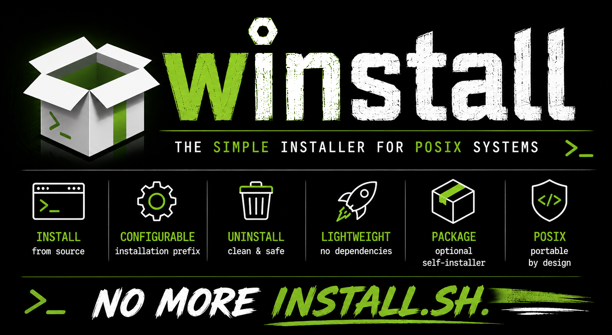

# WInstall - One installer for every project.

## 1.0 Files

|     Files/Dirs   |                     Description                           |
|------------------|-----------------------------------------------------------|
| images           | This folder contains picture used by the README.md files  |
| selfInstPckg     | The C code to build a self-installer software package     |
| winstall.sh      | The bash-installer script                                 |
| extTools         | Tools used by winstall.sh                                 |
| LICENSE-LGPL3.md | LGPL 3 license document                                   |
| Changes.md       | Main changes of every released version                    |
| TODO.md          | Features to implement in the next versions                |

## 2.0 Description

I have created **winstall** project because I was sick to write the usual INSTALL.sh for every project. So, I wrote this software
with the following features:

1) Reading configuration from easy-to-maintain local configuration files.
2) Software installation (file copying) in defined prefix path
3) Pre-install and post-install scripts management
4) Software removing
5) Self-installing package creation

This version (2.x.x) of Winstall has been developed to provide a multi-platform installer software. It means you can use it to install
a software application on different operating systems (Solaris, Linux, Winwows, ...) and you can also create a multi-platform package
that is able to install the application on different harware (IA64, ARM, x86...). On the target host, the lonely requirement is to
have Python3 VM already installed and properly configured.

Like the BASH version, this one is composed by two components: the main one is the **winstall.py** Python executable file (that manages
all the process); the second is the self-installer package generator. In order to use winstall in your source code, I suggest you to
store it (as submodule for example) inside your project, and execute winstall.sh script with the following syntax:

	<path>/winstall.py --cmd={install|uninstall|build|clean|pkg} \
		[--verbose]                    \
		[--tmpFolder=<dir>]            \
		[--dataLogFolder=<dir>]        \
		[--prefix=<dir>]               \
		[--prjName=<string>]           \
		[--version={auto|<n>.<n>.<n>}]

### 2.1 How to write the main configuration file
As you can see in the previous section, you can drive the file installation (or the package creation) using the python application's
arguments. But you can also use the winstall's configuration file (**winstall_conf.yaml**). Anyway, remember that the command-line
arguments overwrite the data originally defined in the configuration file. The configuration file must respect the following syntax:

	PRJNAME:       <string>
	PREINST:       <exec-file>
	POSTINST:      <exec-file>
	PREFIX:        <folder>
	DATALOGFOLDER: <folder>
	TMPFOLDER:     <folder>
	VERSION:       {auto|<n>.<n>.<n>}
	DEPS_LIST:     {auto|<file.so>...}

- **PRJNAME**:       Name of the software. It is used for the filename used to remove the installed files and for the software
                     package filename
- **PREINST**:       Pre-installation step script. The script to execute before the file installation. If it fails then no files
                     will be installed
- **POSTINST**:      Post-installation step script. This script is executed after the file copying step. If it fails then
                     a warning message will be shown on the terminal
- **PREFIX**:        Installed files path prefix. Every installed file will be stored in a sub-folder of this defined prefix
                     (eg. for PREFIX=/usr/local, /bin/foo.bin --> /usr/local/bin/foo.bin)
- **DATALOGFOLDER**: This is the folder where the process will store all information to remove every software installed by
                     winstall
- **TMPFOLDER**:     A temporary folder used by the winstall process to store the collected files
- **VERSION**:       Project software version. If you set it to "auto" then the version will be calculated using GIT and the tags
                     you have created
- **DEPS_LIST**:     List of the dependence so-files to check or "auto" keyword to retrive the list automatically

### 2.2 How to write a sub-folder's configuration file
If you are installing your own software, or creating a software package, then the first step is collecting the files you want
install on the target system. In order to complete this task using the W-install tool, you have to create one configuration file
in every folder where the files are stored. Every winstall-configuration file has one or many YAML items like the following one:

	- <label>:
		source:    <file-to-install>
		target:    <target-path>
		[custCopy: <module-name>]
		beforeCopy:
			- <module-name>: <arguments>
			...
		afterCopy:
			- <module-name>: <arguments>
			...

YAML item properties:

- **source**:     The files to be installed. You can also use wildcards (eg. myProject\*.exe)
- **target**:     The folder where the defined files will be stored. [!] To separates the folders use always the "/" char.
- **custCopy**:   The name of your coustmized module you want to use to manage the file(s) copying. It is optionally
- **beforeCopy**: The list of checks for the target system. If one fails the file will be not installed
- **afterCopy**:  The list of the actions to perform on the installed file

Available "**beforeCopy**" modules as default:

	fileExixts: <filename>
		- <path1>
		[- <path2> ]

It returns true only if the file exists in at least one of the defined paths

	checkForOS:
		Family: {posix|nt}
		OsID:   {linux|solaris|...|win32} # optional

It returns true only if the target operating system is the defined one

	libExists: <library-name>

It returns true only if the library is already installed on the target system

Available "**afterCopy**" modules as default:

	setPermissions: <n><n><n><n>

It sets the installed file(s) permissions. The argument is defined using POSIX syntax

	setOwner: <user>

It configures the installed file(s)'s owner

	registerUpdating:
		address: <int>
		valur:   <data>

This action will be performed only if the target OS is a MS Winows one. The module udate/add a register keyword

### 2.3 How to install a software
After you have created all the winstall's configuration-files, you can proceed with your custom software installation, using
the following command:

	<path>/winstall.sh --cmd=install \
		[--verbose] [--prefix=<dir>] [--prjName=<string>] [--dataLogFolder=<dir>] 

The process will perform the following steps:

1) If a pre-install script (**PREINST**) has been defined, then it will be executed. If it fails the installation process
   will end.
2) The process will scan the current folder (and its sub-folders recursively) to find all the winstall_conf.yaml files.
   Using the information it will install every file in the right place with the defined attributes. The target folder of
   every file depends also by the **PREFIX** configured path. Using "--prefix=<dir>" argument you will overwrite it.
3) If a post-install script (**POSTINST**) has been defined, then it will be executed. If it fails the installation process
   will just print an error message
4) The process will store a file with the list of all installed files, in the folder defined by **DATALOGFOLDER** config-key.
   The name of this file will be equal to the (**PRJNAME**) defined project-name 

### 2.4 How to remove a software
Using winstall you can install and remove all software you need keeping the target system clean and safe. To achieve this result
you need to remove the software using the following syntax:

	<path>/winstall.sh --cmd=uninstall \
		[--verbose] [--dataLogFolder=<dir>] [--prjName=<string>]

The process will perform the following steps:

1) The process will look for the installed files log file (**PRJNAME**) in the proper folder (**DATALOGFOLDER**). If it does
   not exist then the process will end with the warning message "The software is not installed".
2) The log-file will be loaded, and the process will remove all the listed files.
3) The log-file will be removed

### 2.5 What is and how to create a self-installer package

## 3.0 Tests
If you need to see a real-life using test, please consider the following projects of mine:

[virtualOscilloscope](https://github.com/catinella/virtualOscilloscope)

[minute](https://github.com/catinella/minute)

## 4.0 TODO
[TODO](TODO.md)

## 5.0 Changes
[CHANGES](Changes.md)

## 6.0 License
This project is free software, released under the terms of the **GNU Lesser General Public License, version 3 (LGPL-3.0)**.

You are free to use, modify, and redistribute this software in accordance with the terms of the license, including its use
as part of proprietary software, provided that the LGPL-licensed components and any modifications to them remain compliant
with the LGPL-3.0 requirements.

For the complete license terms, please refer to the [LICENSE-LGPL3.md](LICENSE-LGPL3.md) file included with this project.

Copyright © Silvano Catinella
